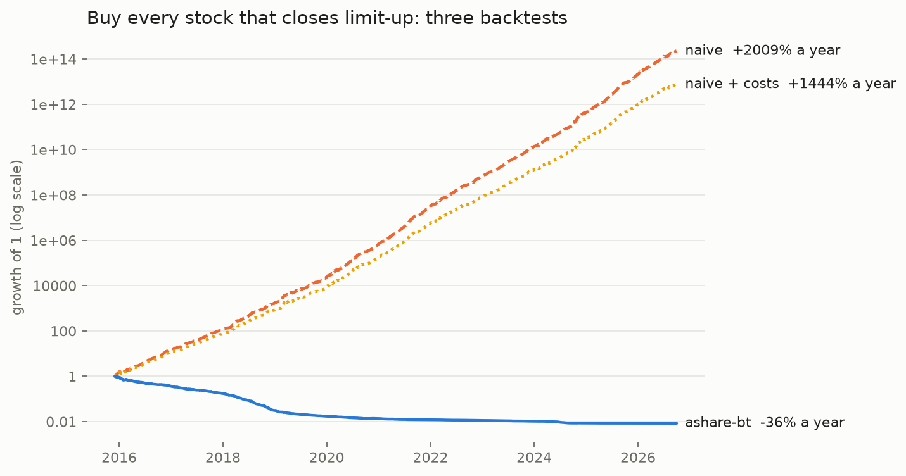

# ashare-bt：A 股日线回测

[](https://github.com/Issac250/ashare-bt/actions/workflows/ci.yml)

把选股分数和日线行情传进来，按下一交易日开盘调仓，输出净值、交易记录和回测指标。基于 pandas，适合已有选股逻辑、想单独检查组合表现的人。

收盘选出的股票，第二天可能涨停买不进；资金分到每只股票后，可能连一手都不够。这些约束，以及最低佣金、滑点和成交额限制，都在回测里计算。

## 同一个信号，三种回测

<picture>
  <source media="(prefers-color-scheme: dark)" srcset="docs/img/naive-vs-real-dark.png">
  
</picture>

信号是打板：每天收盘涨停的非 ST 股票，次日卖出，每只占 1/50 仓位，选不满留现金。数据为 2016-01 至 2026-09 全 A 股日线。

| 回测方式 | 年化 |
|---|---|
| 按涨停收盘价成交，不计费用 | +2009% |
| 按涨停收盘价成交，计费用 | +1444% |
| ashare-bt：下一交易日开盘成交，开盘涨停不买 | −36% |

差距几乎全部来自成交时点。这些股票次日收盘平均比涨停收盘价高约 2%，其中开盘跳空就有约 2.3%。按涨停收盘价成交，等于默认封板时能买到；实际只能第二天开盘买，跳空已经发生。2020 年以后 ashare-bt 的曲线变平，是因为账户只剩约 1%，每只 1/50 的仓位不够买一手。

用自己的日线 parquet 可以复现：`python examples/04_naive_vs_real.py bars.parquet --out chart.png`。数据不随仓库提供。

可以用它做几件事：

- **测自己的信号**：只需要股票评分和日线数据，不用把策略改写成事件回调。
- **看成交假设的影响**：同一信号，比较收盘成交、加费用、下一开盘成交的结果。
- **试资金容量**：从 10 万跑到 1 亿，看成本和闲置现金怎么变化。

需要 Python 3.11+。核心依赖只有 NumPy 和 pandas；下面的示例用合成数据，装好就能跑。成交仍是日线近似，无法模拟开盘集合竞价的排队和部分成交。

## 先跑一遍

```bash
git clone https://github.com/Issac250/ashare-bt
cd ashare-bt
pip install -e .
python examples/01_quickstart.py
```

```python
from ashare_bt import BacktestConfig, run_backtest
from ashare_bt.synthetic import make_market, make_signal

bars = make_market(n_stocks=100, n_days=750, seed=7)
signal = make_signal(bars, kind="momentum", lookback=20)
config = BacktestConfig(capital=1_000_000, n_positions=20, rebalance_days=5)

result = run_backtest(signal, bars, config)
print(result.summary())
print(result.trades.head())
```

运行上面的配置，摘要里会看到这些数值（合成行情，固定随机种子）：

```text
period........... 2020-01-29 -> 2022-11-16 (2.8y)
total return.....    -5.9%
CAGR.............    -2.1%
max drawdown.....   -16.7%
cost drag / yr...    4.33%
```

这组数据只是用来跑通流程，没有内置的盈利策略。换成自己的信号和行情后，可以直接取：

- `result.equity`：净值序列（pandas Series）。
- `result.daily`：每日权益、现金、持仓数、费用和成交金额。
- `result.trades`：每笔交易的日期、代码、方向、金额和费用。
- `result.metrics`：收益率、Sharpe、回撤等指标。

## 数据怎么接

拿到一个选股信号后，可以先用合成数据把流程跑通，再换成自己的日线数据。引擎只接收 pandas DataFrame，不依赖数据库或行情服务。

`signal` 每行是一只股票在一个信号日的评分：

| 列 | 含义 |
|---|---|
| `date` | 信号日 |
| `code` | 股票代码，与 `bars` 一致 |
| `score` | 分数越高，排名越靠前；空值不参与选股 |
| `w`（可选） | 相对仓位权重；不传时等权 |

`bars` 需要这些列：

| 列 | 含义 |
|---|---|
| `date`, `code` | 交易日、股票代码 |
| `open`, `close` | 未复权开盘价、收盘价 |
| `preclose` | 当日除权口径的昨收，用来计算隔夜收益 |
| `amount` | 当日成交额，单位元 |
| `tradable` | 当日是否可交易 |
| `open_limit_up`, `open_limit_down` | 开盘时是否在涨停、跌停价 |

`ret` 不是引擎的必需列，但示例里的 `make_signal` 用它计算动量。

涨跌停标记要看开盘。开盘正常、收盘才涨停的股票，不能因为收盘结果被排除。旧字段名 `at_limit_up` / `at_limit_down` 会报错，避免把收盘口径直接带进来。标记为空时，引擎会阻止对应方向的交易；`tradable` 为空则按不可交易处理。

可以用 `ashare_bt.sizing.limit_prices(preclose, width)` 算涨跌停价。它按分做四舍五入，处理了 `27.95 × 1.1 = 30.745` 这类浮点舍入问题。`width` 要按股票和日期提供，不能把全市场都设成 10%。

`preclose` 的口径也要确认：引擎用 `open / preclose` 和 `close / open` 推进持仓价值。除权日如果传了未经调整的昨收，送转就会被算成价格下跌。这里按收益率记持仓价值，没有逐笔维护分红现金和送转后的股数。

运行期间每个交易日都要有信号记录。引擎只遍历输入的信号日；稀疏事件信号需要先补齐日期，才能逐日估值和检查退出。

## 回测里的交易约定

信号日 t 的订单在下一交易日开盘执行。每次调仓按评分选前 `n_positions` 只股票；默认每 5 个信号日调一次。选不满时留现金，例如目标 20 只、只选到 10 只，等权组合的目标仓位就是约 50%。

| 项目 | 默认值或处理方式 |
|---|---|
| 买入股数 | 向下取整到 100 股一手 |
| T+1 | 当天买入的持仓当天不能卖 |
| 涨停开盘 | 不买入、不加仓；已有持仓可以保留 |
| 跌停开盘、停牌 | 卖单跳过，持仓继续保留 |
| 买单金额上限 | 前 20 个交易日成交额中位数的 5%，至少需要 5 条历史记录 |
| 佣金 | 万 2.5，每笔最低 ¥5 |
| 过户费 | 双边十万分之一 |
| 滑点与冲击成本 | 成交额 ×（5bp + 0.10 × 参与率） |
| 印花税 | 卖出 0.05%；历史回测可按日期取税率 |

费用通过 `CostModel` 设置，买入金额上限通过 `max_participation` 设置。滑点和冲击成本从现金中扣除。成交额历史不足或无效时，买单会退回目标仓位和现金约束，不应用成交额上限；卖单也不受这个上限约束。

还有几个按需使用的参数：

- `rebalance_weights=False`：调仓时不修正已有持仓的权重漂移。
- `rebalance_dates`：指定调仓的信号日，替代固定间隔。
- `exposure`：传给 `run_backtest` 的 Series，按信号日设置股票仓位比例。降低已有仓位需要保留 `rebalance_weights=True`。
- `exit_flags`：传入 `[date, code]`，在下一交易日开盘尝试退出。每个信号日都会检查；卖不掉时，需要在后续日期继续给出标记。
- `refill=True`：退出后在同一执行日开盘补入其他股票；默认让现金等到下次调仓。
- `cash_annual_rate`：闲置现金的年利率，默认 0。
- `settlement_t0`、`lot_size`、`costs`：可调整交收、每手数量和费用，例如用不同约定跑可转债。

一只股票的数据提前结束后，引擎会在后续执行日按最后持仓价值转回现金，记录为 `delist`，不收费用。这是处理数据结束的简化方式，缺失数据也会触发它；不能把这笔金额当作真实退市回收款。

## 历史印花税

跨年份回测可以用 `CostModel(historical_stamp_duty=True)`。内置表从 2001-11-16 开始，早于这个日期会报错。

| 生效日 | 买方 | 卖方 |
|---|---|---|
| 2001-11-16 | 0.2% | 0.2% |
| 2005-01-24 | 0.1% | 0.1% |
| 2007-05-30 | 0.3% | 0.3% |
| 2008-04-24 | 0.1% | 0.1% |
| 2008-09-19 | 0 | 0.1% |
| 2023-08-28 | 0 | 0.05% |

来源：[历次调整汇总（财联社）](https://www.cls.cn/detail/1433377)、[2008 年改为单边征收（中新网）](https://www.chinanews.com/cj/agyw/news/2008/09-18/1386777.shtml)、[2023 年减半征收（新华网）](https://www.news.cn/2023-08/28/c_1212260850.htm)。这个开关只调整印花税，其他费用仍使用 `CostModel` 的配置。

## 指标与示例

CAGR 主要按日历天数 / 365.25 计算，极短区间有最小年数保护。波动率和 Sharpe 按 252 个交易日年化，Sharpe 的无风险利率为 0。现金利息按年利率 / 243.6 在每个执行日计提。

| 示例 | 内容 |
|---|---|
| [01_quickstart.py](examples/01_quickstart.py) | 合成数据上的 20 日动量组合 |
| [02_capacity_sweep.py](examples/02_capacity_sweep.py) | 同一信号在 10 万到 1 亿资金下的结果 |
| [03_fetch_with_baostock.py](examples/03_fetch_with_baostock.py) | 拉取几只股票的日线，需要 `pip install -e '.[baostock]'` 和网络；单线程运行 |
| [04_naive_vs_real.py](examples/04_naive_vs_real.py) | 用涨停或反转信号比较收盘成交、加费用、下一开盘成交三种回测 |

合成行情是随机游走，用来检查规则和跑示例，不能用它判断策略有没有收益。第 4 个示例默认用涨停信号，加 `--signal reversal` 可切换为反转信号，也能读自己的 parquet 文件；需要另装 parquet 引擎（如 `pyarrow`），保存图表还需要 `matplotlib`。

## 开发

```bash
pip install -e '.[dev]'
ruff check .
pytest -q -W error::FutureWarning
```

测试用小规模合成数据覆盖成交时点、涨跌停、成本、仓位、除权和输入检查。项目目前只做日线多头回测，没有盘口、分钟数据或做空模型。

## 许可证

[MIT](LICENSE)。

如果这个项目对你有用，欢迎点个 Star。数据接入或回测结果有问题，可以在 [Issues](https://github.com/Issac250/ashare-bt/issues) 里附上最小复现。
